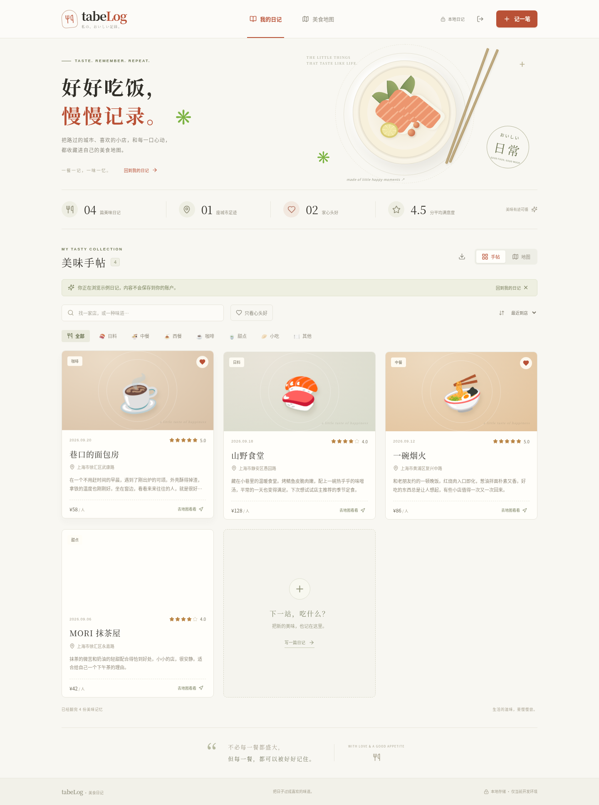
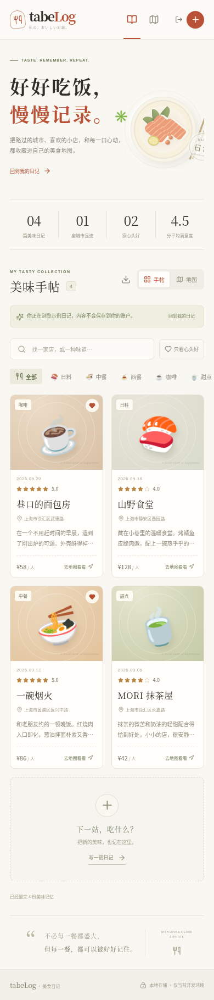

# tabeLog · 美食日记

好好吃饭，慢慢记录。一个个人私密的美食地图与图文日记，使用 **Next.js + Vercel + Cloudflare D1 / R2**。

## 界面预览

桌面版（示例日记）：



<details>
<summary>查看手机版截图</summary>



</details>

## 功能

- 地图标记吃过的店，保存店名、城市、地址、到店日期、料理分类、1–5 星评分、人均消费、币种和图文评论。
- 每篇最多 6 张照片；浏览器先压缩，服务端重新解码、调整方向并转换 WebP，移除 EXIF。支持查看多张照片、编辑和删除。
- 手帖与地图视图、关键词搜索、分类筛选、心头好、评分/日期排序、JSON 文字与坐标导出。
- **OpenStreetMap / Google 地图 / 高德地图**切换。Google、高德支持店铺搜索；所有地图支持选点、定位、已记录店铺标记。无密钥可使用 OSM，也可手填坐标。
- 统一以 **WGS-84** 保存坐标；高德展示和搜索结果自动与 **GCJ-02** 双向转换。
- 单人密码登录、HttpOnly 签名会话、来源校验、数据库登录限流；图片需要登录才可读取。
- 响应式中文界面。示例日记仅用于预览，不写入真实数据库。

这是单用户的私人日记，尚不包含多人注册、公开分享或第三方 OAuth。

## 本地运行

需要 Node.js **22.13+**，建议 Node.js 24 LTS；自带 `node:sqlite`，无需另装数据库。

```sh
npm ci
npm run dev
```

访问开发服务即可。未设置云端配置时，开发模式自动使用 `.data/diary.sqlite` 和 `.data/photos/`，无需账号或密钥。`.data` 与 `.env*` 均不会提交。**本地默认无密码，只能用于可信的开发环境**；请勿把该开发服务暴露到公网。若本地也要测试登录，在 `.env.local` 设置 `DIARY_PASSWORD`（至少 12 字符）与随机 `SESSION_SECRET`（至少 32 字符）。

本地运行生产构建：

```sh
npm run build
STORAGE_MODE=local npm start
```

生产环境默认要求云存储与登录配置。Vercel 上明确禁止使用 `STORAGE_MODE=local`，不会静默回退到临时磁盘。设置 `STORAGE_MODE=cloudflare` 可在本地连接云端。

## 部署到 Vercel，存储使用 Cloudflare

### 1. 创建 Cloudflare 数据库和私有图片桶

在 Cloudflare 控制台创建：

- D1 数据库，如 `tabelog`，记录 **Account ID** 与 **Database ID**。
- R2 桶，如 `tabelog-photos`。保持私有，不必开启 `r2.dev` 或公开访问。
- 一个仅授权目标账户 **D1 Edit** 的 API Token。
- 一个限于该 R2 桶、具有 **Object Read & Write** 权限的 R2 API Token，取得对应的 **Access Key ID / Secret Access Key**。

R2 可能要求账户开通服务/绑定付款方式，费用按 Cloudflare 规则计算。图片由 Vercel 的登录保护接口读取，因此不需要浏览器直传 CORS 或公开图片域名。

把以下变量安全地写入本机 `.env.local`（不要提交），也在 Vercel 的项目环境变量中设置：

| 变量                        | 内容                                  |
| --------------------------- | ------------------------------------- |
| `CLOUDFLARE_ACCOUNT_ID`     | Cloudflare Account ID                 |
| `CLOUDFLARE_D1_DATABASE_ID` | D1 Database ID                        |
| `CLOUDFLARE_API_TOKEN`      | 具有 D1 Edit 权限的 Token             |
| `R2_BUCKET_NAME`            | 私有图片桶名称                        |
| `R2_ACCESS_KEY_ID`          | R2 S3 Access Key ID                   |
| `R2_SECRET_ACCESS_KEY`      | R2 S3 Secret Access Key               |
| `DIARY_PASSWORD`            | 自己设置的私人密码，至少 12 字符      |
| `SESSION_SECRET`            | `openssl rand -hex 32` 生成的随机密钥 |

以上均为**服务端变量**，不要加 `NEXT_PUBLIC_` 前缀。R2 使用 S3 签名，`R2_SECRET_ACCESS_KEY` 必须是运行进程中的实际秘密值，不能使用仅支持 HTTPS 请求替换的代理占位符。不要把密码或密钥发在聊天或写进代码。

初始化表（可重复执行，不清空已有数据）：

```sh
npm run cloudflare:init
```

> 如终端使用 HTTP 代理，需要 Node 启用其支持的代理路由，例如 `NODE_USE_ENV_PROXY=1 npm run cloudflare:init`。保留平台 CA 和 TLS 校验。

### 2. 配置地图（选配）

OSM 无需密钥；请遵守 [OSM tile usage policy](https://operations.osmfoundation.org/policies/tiles/)。默认接入适合个人低流量使用，不提供离线地图或批量下载。大流量使用应换商业瓦片服务。OSM 模式不请求公共地理编码接口，支持手动选点和输入坐标。

**Google 地图**：

1. Google Cloud 中启用 **Maps JavaScript API** 和 **Places API (New)**，开通相应结算。
2. 创建浏览器密钥，限制 API 范围和允许的 HTTP referrer 域名。
3. 设置 `NEXT_PUBLIC_GOOGLE_MAPS_API_KEY`。

**高德地图**：

1. 高德开放平台创建 **Web 端（JS API）** Key，并取得配套的 `securityJsCode`。
2. 设置 `NEXT_PUBLIC_AMAP_KEY` 和 `NEXT_PUBLIC_AMAP_SECURITY_JS_CODE`。
3. 根据平台要求配置允许访问的域名与服务权限。

`NEXT_PUBLIC_*` 地图变量会编译进浏览器，因此必须在 **Vercel 构建前设置**，修改后重新部署；浏览器地图 Key 不等于服务端凭据，请限制域名与额度。Google、高德的实际连通性、搜索权限、配额、费用及地域可用性取决于各平台和访问网络。高德的 `securityJsCode` 在此采用官方浏览器配置方式，不能当作隐藏的服务端秘密。

### 3. 发布 Vercel

可将本项目推送到 GitHub 后，在 Vercel 选择 **Add New → Project → Import**；框架选 Next.js，Node.js 选 24.x，填好上面的环境变量，再部署。或在项目根目录使用 CLI：

```sh
npx vercel login
npx vercel link
npx vercel deploy --prod
```

CI 可使用已经安全配置的 Vercel Token，不要把 Token 写入脚本或提交到仓库。Vercel 会按 `vercel.json` 安装、构建并部署。**不要在 Vercel 设置 `STORAGE_MODE=local`**。

部署后按以下清单验证：

1. 未登录访问日记需要密码；错误密码不能登录。
2. 登录后新增一篇带照片和位置的日记；刷新/重新登录后仍然存在。
3. 直接读取未登录的 `/api/entries`、`/api/photos/<id>` 应返回 401。
4. 在三个地图服务之间切换，确认域名限制正确；高德搜索与地图坐标应一致。
5. 编辑、删除一条测试记录，确认 D1 和 R2 同步更新。

当前仓库代码和本地测试不代表已经创建了 Cloudflare 资源或发布到 Vercel。只有获得相关账号授权并完成上述操作，才能得到真实线上地址。

## 验证与测试

```sh
npm run typecheck
npm test
npm run build
npm run test:e2e
```

端到端测试覆盖真实浏览器中的登录、上传照片、服务端读取、持久化、编辑、筛选、地图服务缺失密钥提示、导出、删除、退出登录、CSRF 与移动端布局。浏览器测试使用隔离的 `/tmp/tabelog-e2e` 数据目录；不影响开发日记。默认使用 `/usr/bin/chromium`，也可通过 `PLAYWRIGHT_CHROMIUM_EXECUTABLE_PATH` 指定浏览器路径。地图瓦片在端到端测试中故意断网，以验证失败提示与日记操作不受底图影响；**不代表 Google、高德或 Cloudflare 线上集成已验证**。

## 数据与运行说明

- 本地数据可以通过复制整个 `.data/`（停服后）备份。云端按 Cloudflare D1 / R2 的备份机制处理；UI 导出只包含文字、坐标、图片引用，不包含图片文件，不能当作完整图片备份。
- 图片上传原文件每张上限 5 MB，最多 6 张；浏览器压缩后合计上限 3.5 MB，服务端请求上限 4 MB，以兼容 Vercel 的 4.5 MB 请求限制。只接受 JPG、PNG、WebP。
- D1 的数据库访问通过 Cloudflare HTTPS API，R2 通过兼容 S3 的 SDK，不依赖 Worker 或公开桶。
- 删除时先删除日记，再尽力清理对应图片。极端网络故障下清理失败会记录服务端错误，可能留下无人引用的对象；重要数据请使用备份。
- 并发编辑使用 `updatedAt` 乐观锁，冲突时提示刷新，避免覆盖其他窗口的修改。
- `SESSION_SECRET` 更换后所有既有会话失效；会话默认 7 天。登录每 IP 每 15 分钟最多 15 次；预览部署不要连接正式数据，以免测试误删真实日记。
- 不使用前端服务端密钥、公开写数据库权限或永不失效的图片公开链接。

## 目录

```text
app/                页面、全局样式与私密 API
components/         手帖、日记表单、地图适配器与弹窗
lib/                认证、校验、D1/SQLite、R2/本地存储、坐标转换
scripts/            D1 schema 与初始化命令
tests/              数据校验/坐标测试、Playwright 端到端测试
.env.example        可复制的配置模板（不含秘密）
```
