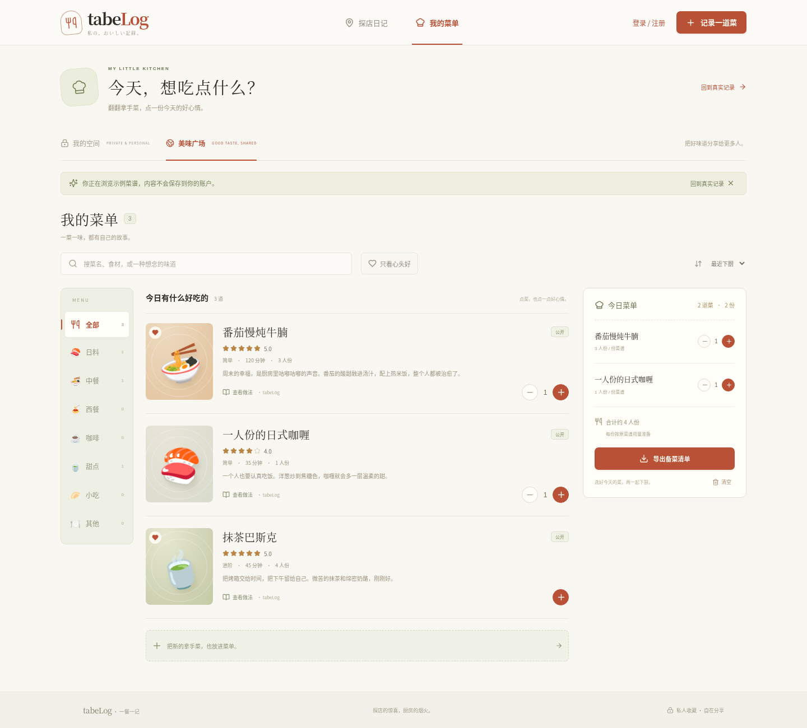
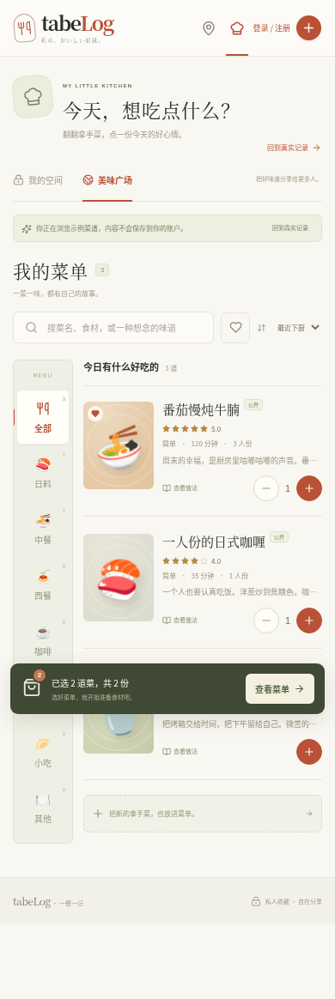
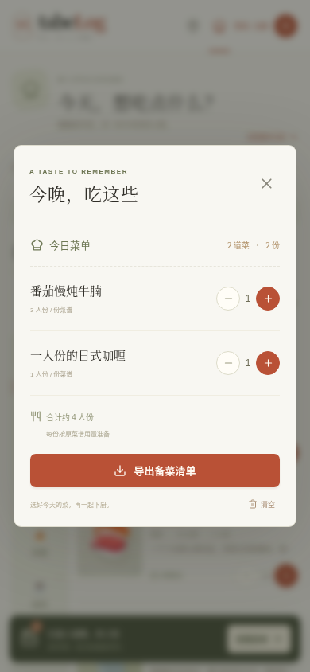
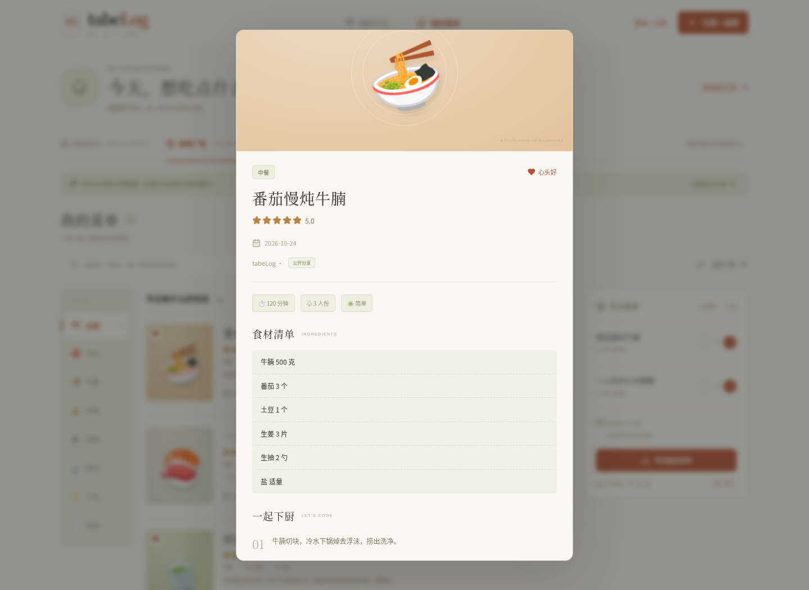

# tabeLog · 探店日记 & 我的菜单

在外寻味，也在家寻常。一个支持独立用户账户、私人收藏和公开分享的美食记录应用，采用 **Next.js + Vercel + Cloudflare D1 / R2**。

## 两个模块

| 模块         | 可以记录的内容                                                                 |
| ------------ | ------------------------------------------------------------------------------ |
| **探店日记** | 吃过的店、地图位置、城市、地址、评分、到店日期、人均消费、图文评论             |
| **我的菜单** | 自己做过的菜、食材与用量、分步做法、用时、份量、难度、下厨日期、评分、图文照片 |

两个模块都支持新增、查看、编辑、删除、分类筛选、搜索、心头好、排序，以及 JSON 文字导出。每篇最多上传 6 张照片；图片先在浏览器压缩，再由服务端检查实际格式、调整方向并转为 WebP、移除 EXIF。

## 手机点餐式浏览

- **我的菜单**：左侧分类、右侧图文菜品列表。可加减份数，手机底部显示已选菜单，点击展开今日菜单并导出备菜清单；桌面将已选菜单固定在右侧。
- **探店日记**：默认采用「上方地图、下方店铺列表」。上下滚动列表时地图保持可见，点地图标记会选中对应店铺，点列表的地图定位会高亮并定位标记；手机为单列，桌面为双列店铺列表。
- 收起了大幅首页介绍，进入后直接浏览；两个模块保留搜索、分类、心头好、排序、编辑、上传与私人 / 公开设置。
- 今日菜单在本次浏览中保留，搜索、分类和模块切换不会清掉已选份数；刷新、切换账户 / 浏览空间 / 示例模式后需重新选择。备菜清单按每道菜的原菜谱份量注明倍数，食材文字不自动换算单位。

## 账户与公开 / 私人

- 邮箱、昵称、密码注册；密码要求 12–128 字符，用随机盐和 scrypt 哈希保存。
- 登录后进入「我的空间」，可管理自己的私人和公开记录；每次新建默认 **私人**。
- 保存前选择「公开分享」后，记录会出现在「美味广场」，并具有独立的 `/share/<id>` 分享页。
- 访客无需登录即可浏览公开记录；只有作者可以修改或删除。公开列表仅展示昵称，不展示账户邮箱或密码信息。
- 私人内容在列表、详情、分享页、图片接口均受服务端权限校验。公开改回私人后，原链接和照片对其他人返回 404；图片使用 `private, no-store`，避免隐私切换后的缓存继续展示。
- 会话使用 HttpOnly / SameSite Cookie，生产开启 Secure；会话 token 摘要存数据库，退出登录会吊销会话。登录、注册均有来源校验和每 IP 每 15 分钟最多 15 次尝试限制。
- `REGISTRATION_OPEN=false` 可关闭新用户注册，已存在用户仍可登录。

当前使用邮箱和密码直接登录；邮箱只是登录标识，**暂不提供验证邮件、找回密码或第三方 OAuth**。

## 界面预览

我的菜单（示例数据，不写入用户账户）：





<details>
<summary>查看探店、手机版与菜谱详情</summary>


探店截图使用离线底图展示地图与店铺列表的交互；真实瓦片需要地图服务正常连接。







</details>

## 本地运行

需要 **Node.js 22.13+**，建议 Node.js 24 LTS。

```sh
npm ci
npm run dev
```

未配置云端时，开发模式使用 `.data/diary.sqlite` 和 `.data/photos/`，自动创建表。无需 Cloudflare 账号即可开发。**本地也需要注册 / 登录后才能写入记录**，不会自动绕过权限。未配置 `SESSION_SECRET` 时，本地生成的随机密钥保存在被忽略的 `.data/session-secret` 中。

本地运行生产构建：

```sh
npm run build
STORAGE_MODE=local npm start
```

Vercel 上禁止使用 `STORAGE_MODE=local`，不会回退到临时磁盘。设置 `STORAGE_MODE=cloudflare` 可在本地使用云存储；生产必须配置数据库、R2 与 `SESSION_SECRET`。

## 地图服务

探店模块支持 **OpenStreetMap、Google 地图、高德地图**。所有记录统一以 **WGS-84** 保存坐标，高德的 GCJ-02 坐标在适配器中双向转换；「我的菜单」不要求地图位置。

- **OpenStreetMap**：无需密钥，支持点击选点、定位、已记录店铺标记，也可手填经纬度。遵守 [OSM 瓦片使用政策](https://operations.osmfoundation.org/policies/tiles/)，个人低流量使用不提供离线/批量下载；高流量需换商业瓦片服务。未使用公共地理编码接口。
- **Google 地图**：在 Google Cloud 启用 **Maps JavaScript API** 和 **Places API (New)**、开通结算，设置 `NEXT_PUBLIC_GOOGLE_MAPS_API_KEY`。支持店铺搜索；限制浏览器 Key 的域名、API 范围和配额。
- **高德地图**：申请 **Web 端（JS API）** Key，设置 `NEXT_PUBLIC_AMAP_KEY` 与配套 `NEXT_PUBLIC_AMAP_SECURITY_JS_CODE`，配置域名和服务权限。支持店铺搜索。

地图 `NEXT_PUBLIC_*` 变量会编译进浏览器，须在 Vercel 构建前设置，修改后重新部署。高德 securityJsCode 在此采用官方浏览器配置方式。服务可用性、费用、搜索权限、地域网络条件由各地图平台决定。

## 部署到 Vercel，存储使用 Cloudflare

### 1. 创建 D1 和私有 R2 桶

在 Cloudflare 控制台创建：

1. D1 数据库，如 `tabelog`，记录 Account ID 与 Database ID。
2. R2 桶，如 `tabelog-photos`，保持私有，不开启公开 `r2.dev`。
3. 仅授权目标账户 **D1 Edit** 的 API Token。
4. 限定目标 R2 桶、具有 **Object Read & Write** 权限的 R2 S3 Access Key ID / Secret Access Key。

R2 按 Cloudflare 规则开通和计费。图片由带权限检查的 Vercel 接口读取，不需要公开桶或浏览器直传 CORS。

### 2. 安全配置环境变量

| 变量                        | 用途                                  |
| --------------------------- | ------------------------------------- |
| `CLOUDFLARE_ACCOUNT_ID`     | Cloudflare Account ID                 |
| `CLOUDFLARE_D1_DATABASE_ID` | D1 Database ID                        |
| `CLOUDFLARE_API_TOKEN`      | D1 Edit Token                         |
| `R2_BUCKET_NAME`            | 私有图片桶名称                        |
| `R2_ACCESS_KEY_ID`          | R2 S3 Access Key ID                   |
| `R2_SECRET_ACCESS_KEY`      | R2 S3 Secret Access Key               |
| `SESSION_SECRET`            | 生产必填，`openssl rand -hex 32` 生成 |
| `REGISTRATION_OPEN`         | 默认 `true`，设 `false` 关闭新注册    |

这些是服务端变量；不要加 `NEXT_PUBLIC_` 前缀，不要提交 `.env.local`。R2 使用 S3 签名，秘密密钥必须是运行进程中的真实值，不能使用仅支持 HTTP 请求替换的代理占位符。旧版 `DIARY_PASSWORD` 已不再使用。

在本机 `.env.local` 中安全配置 D1 后执行：

```sh
npm run cloudflare:init
```

该命令创建/补充表和索引，可重复执行，不清空已有记录。使用 HTTP 代理的 Node.js 24 环境可运行 `NODE_USE_ENV_PROXY=1 npm run cloudflare:init`，保留 CA 信任和 TLS 校验；R2 SDK 也会使用继承的 HTTPS 代理。

### 3. 发布 Vercel

从 [GitHub 仓库](https://github.com/Linkyyy/tabeLog) 导入 Vercel，选择 Next.js 和 Node.js 24.x，填入变量后部署。也可以使用 CLI：

```sh
npx vercel login
npx vercel link
npx vercel deploy --prod
```

CI 使用安全配置的 Vercel Token；不要把 Token 写进代码。`vercel.json` 已配置安装、构建和 API 执行时限。Vercel 不要设置 `STORAGE_MODE=local`。预览部署建议使用独立 D1/R2 数据集。

发布后注册自己的账户，分别新增一条探店、一篇菜谱，上传照片；刷新后检查持久化，再用无痕窗口测试公开分享和私人权限。若仅供有限用户使用，创建完账户后可关闭注册并重新部署。

本地验证和 GitHub 推送不代表已创建云资源或发布 Vercel，真实线上验证须配置账号凭据后执行。

## 从旧版共享密码日记升级

旧表与已有内容会保留。旧记录没有账户归属，**不会自动分给第一个注册的人，也不会公开**；原来的共享密码会话不具备新账户权限。

管理员先备份数据库和图片，升级 schema 并注册目标账户。确认其 `user.id`（可从登录后的 `/api/session` 响应查看）后，在可信的管理终端运行：

```sh
npm run data:claim -- <已有账户的 user.id>
```

此命令只把尚无 ownerId 的旧记录分配给指定已有账户，全部保持私人；已有归属记录不会变动。可重复执行。本地使用相同 `.data` 或 `LOCAL_DATA_DIR`，云端使用安全配置的 D1 环境变量。此操作只能在可信管理员终端执行，没有对外开放认领接口。

## 验证与限制

```sh
npm run typecheck
npm test
npm run build
npm run test:e2e
# 也可以测试已构建的生产版本
E2E_PRODUCTION=1 npm run test:e2e
```

测试使用独立 `/tmp/tabelog-e2e` 数据和 `/usr/bin/chromium`（可通过 `PLAYWRIGHT_CHROMIUM_EXECUTABLE_PATH` 指定路径），覆盖：

- 注册、登录、错误密码、退出后的会话吊销；
- 两个模块、探店地图选点、图文菜谱上传与持久化、编辑、搜索、导出和删除；
- 两个独立账户与匿名访客的权限隔离、伪造 ownerId、越权写入、并发冲突；
- 公开分享与图片可访问、改回私人后原链接失效、旧版记录不被新用户获取；
- 手机布局与示例内容不写入真实账户；
- 点餐式分类、加减份数、筛选与模块切换保留选择、备菜清单导出、320/390/768 宽度无横向溢出；
- 手机及桌面的上图下店布局、地图标记与店铺行双向选择、桌面已选菜单侧栏。

地图瓦片在浏览器测试中可故意断网；这验证了错误处理，不代表已验证 Google、高德或 Cloudflare 线上服务。

图片单张原文件上限 5 MB，最多 6 张；浏览器压缩后合计上限 3.5 MB，服务端请求上限 4 MB，兼容 Vercel 的 4.5 MB 请求限制。只接受 JPEG、PNG、WebP 的实际图片内容。

导出的 JSON 仅含文字、坐标和照片引用，不包含图片文件。完整本地备份应停服后复制 `.data/`；云端按 D1/R2 的备份机制处理。删除先移除记录，再尽力清理图片；网络故障可能留下未被引用的 R2 对象，清理失败会记录服务端错误。公开内容曾被他人下载的副本无法撤回。
