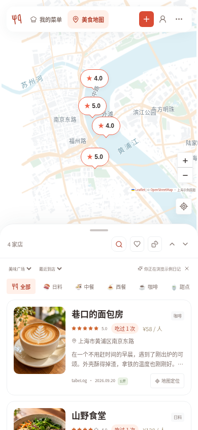
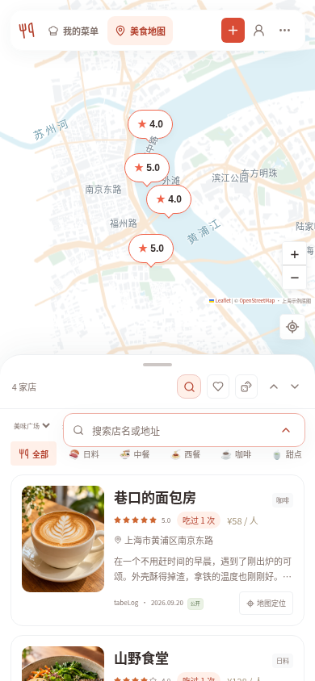
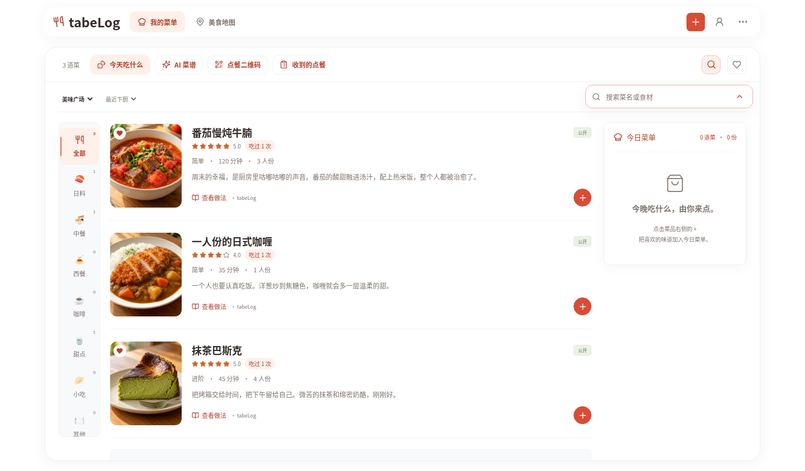
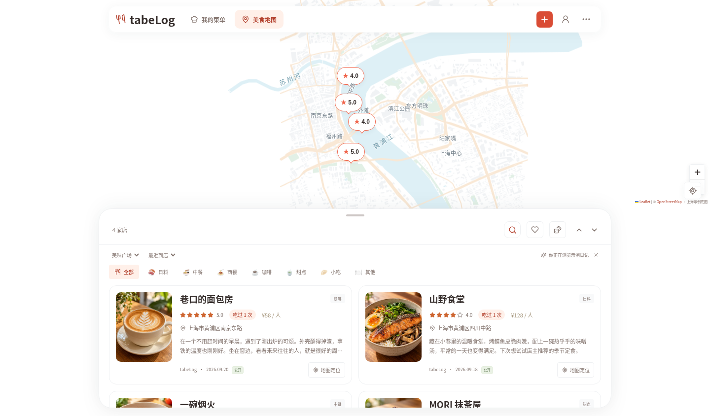
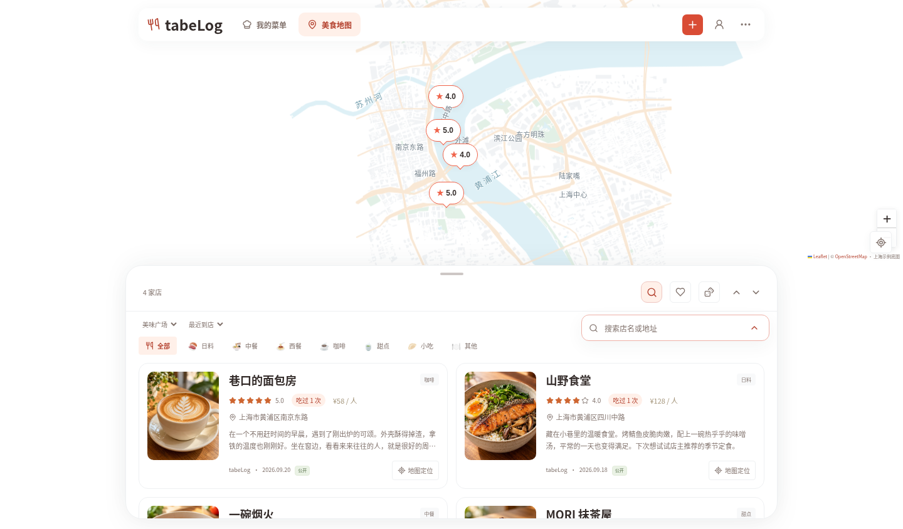

# 紧凑搜索

实际运行界面截图，使用示例内容；食物图片沿用项目已标注的 AI 演示图片。

搜索默认收起为小放大镜按钮。点击后出现浮层并自动聚焦，不增加工具栏高度。收起、按 Esc 或点击其他位置不会清空已输入的关键词；小圆点提示当前正在筛选，重新展开可修改或清空。

## 手机菜单

搜索、收藏和四个常用工具放在同一行，原来搜索框独占的一行已移除。

 

## 手机美食地图

搜索入口与店铺数量、收藏、抽签和抽屉操作放在同一行。抽屉收起时，点击放大镜会打开抽屉后再聚焦搜索。

 

## 电脑布局

