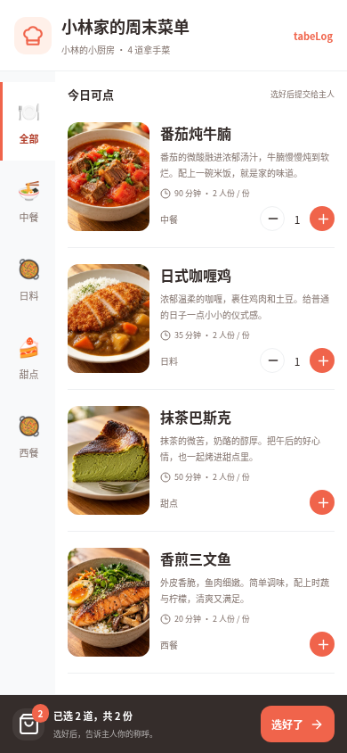
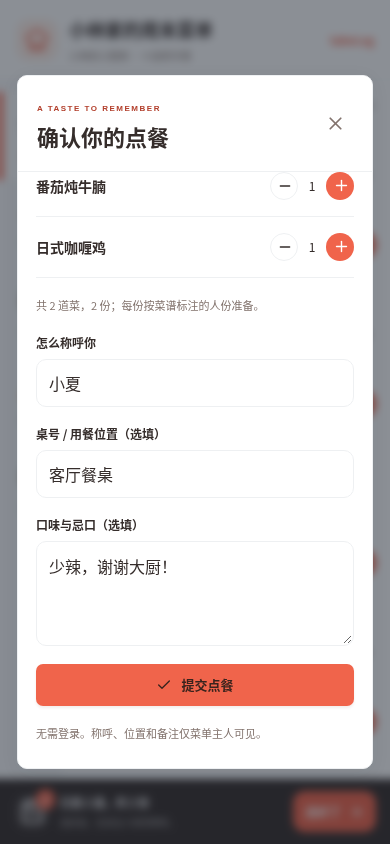
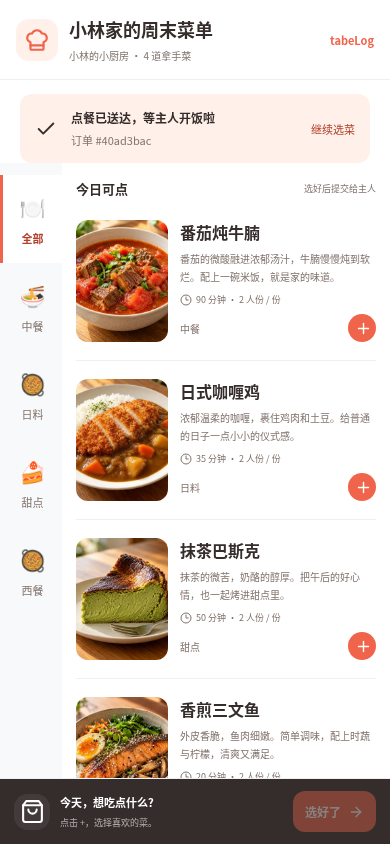
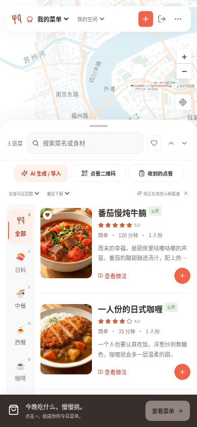
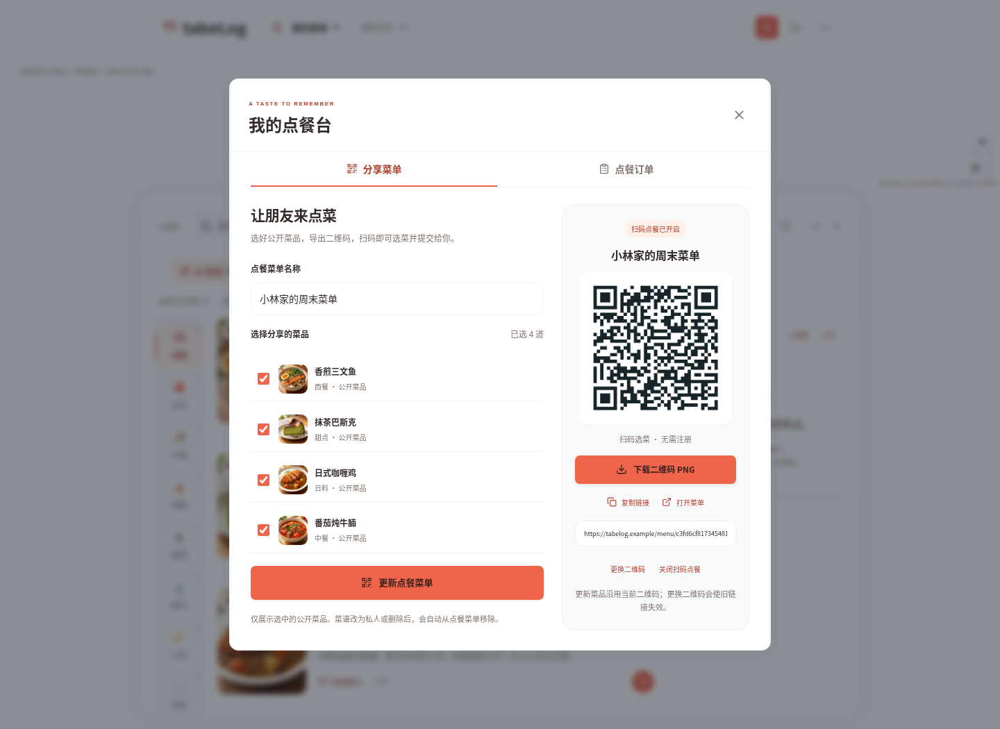
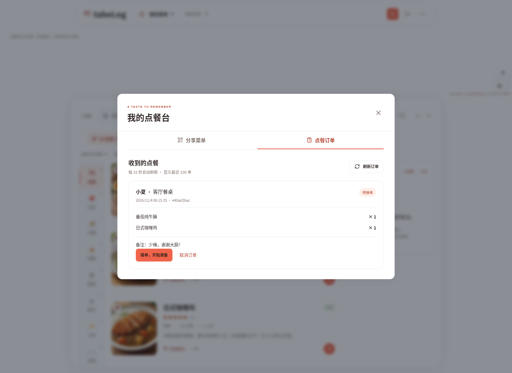
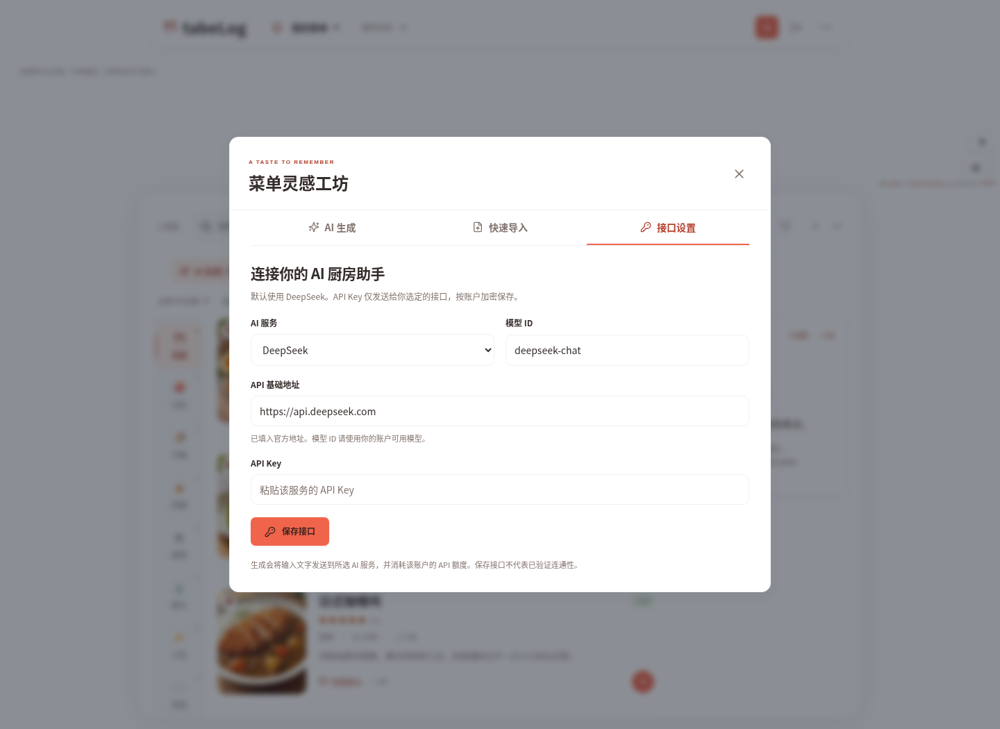
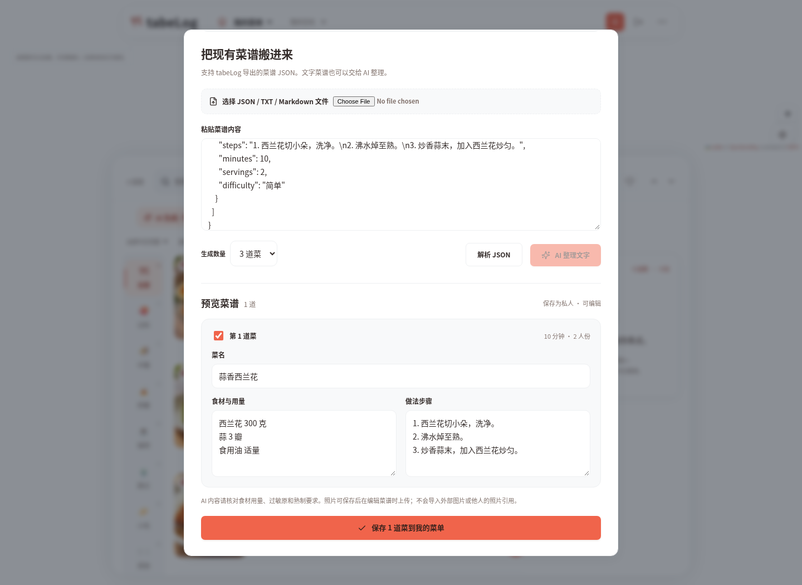
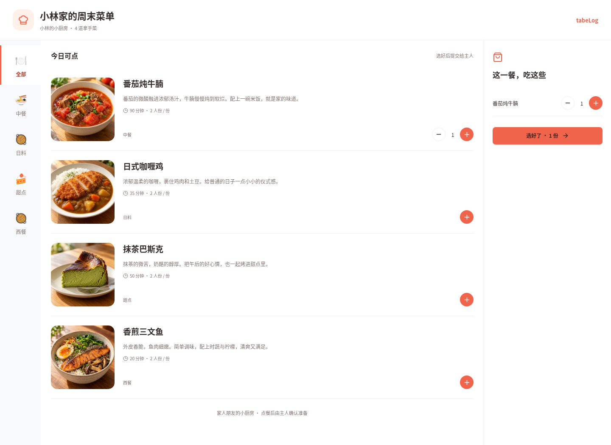

# 我的菜单 · AI 与扫码点餐

以下均为实际运行界面截图，使用隔离的演示账户与示例菜谱。食物图片沿用项目明确标注的 AI 演示图片。截图中的 `tabelog.example` 和二维码仅作展示，不能作为线上点餐入口；实际请在已部署、手机可访问的网站生成二维码。

## 手机扫码选菜与下单

 

 

## 分享与接单

选择自己公开的菜谱并导出二维码，访客无需注册即可点餐。私人菜谱不可选；分享可以关闭或更换二维码。

主人查看点餐、接单并标记完成；称呼、位置和忌口只对主人可见。

## AI 接口与批量导入

默认 DeepSeek API 基础地址为 **`https://api.deepseek.com`**，模型 ID 默认为 `deepseek-chat`。也支持 OpenAI、通义千问、Kimi、GLM、Claude、Gemini 和管理员允许的自定义 OpenAI 兼容接口。API Key 按账户加密保存。

下图通过实际 JSON 解析产生预览，可修改、选择后批量保存为私人菜谱。普通文字可使用配置后的 AI 整理。截图与自动化测试不代表已使用真实付费模型；真实调用需要用户自己的 API Key。

## 桌面点餐页

