# 价格、用餐记录与抽签

以下是实际运行的新版界面，使用隔离的演示账户与菜谱，不包含真实用户数据。食物图沿用项目已标注的 AI 演示图片。AI 快速填入和文章导入展示操作入口，不代表真实付费模型或所有平台链接都已在线验证。

## 手机菜单与新按钮

空菜单的按钮改为轻量胶囊样式，使用主题强调色。主操作按钮改用白色文字；工具按钮使用主题强调色。

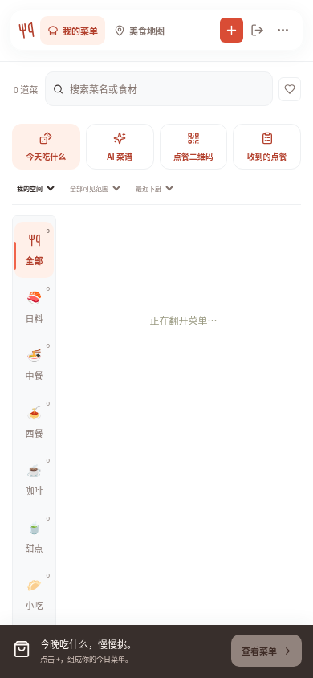 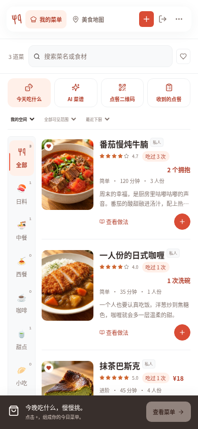

## 快速填入与文章导入

先写菜名，再点 AI 快速填入；也可展开文章导入，粘贴链接或菜谱正文，整理后继续手动修改，点击保存才会入库。DeepSeek 默认 API 地址为 `https://api.deepseek.com`。标准 Recipe 网页可直接导入；其他正文需要配置自己的 AI 接口。受平台登录 / 验证限制时，可复制正文导入，图片自行上传。

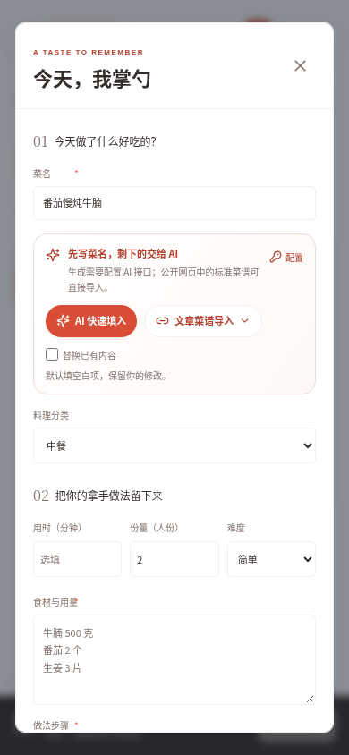 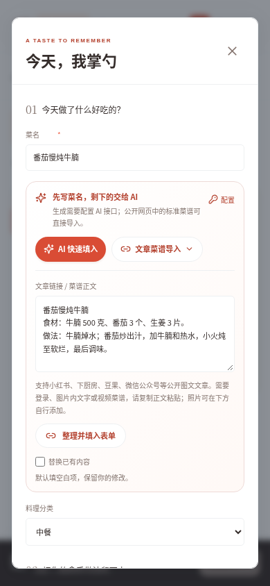

## 一菜一记与每次评价

价格可不填，也可用次洗碗、杯奶茶、拥抱、小心心或自定义单位。用餐历史跟随条目的私人 / 公开状态。现有日记作为首次记录，后续每次可独立填写日期、评分、评价、照片和花费。

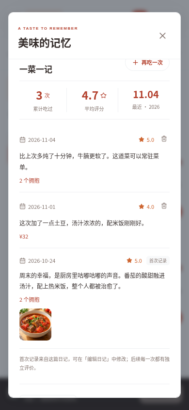 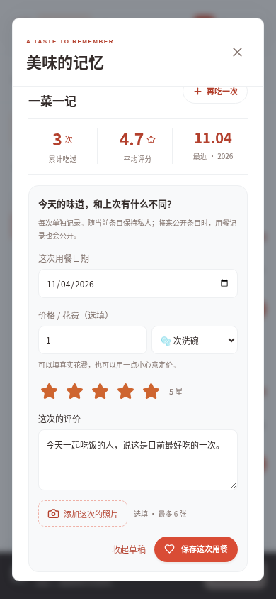

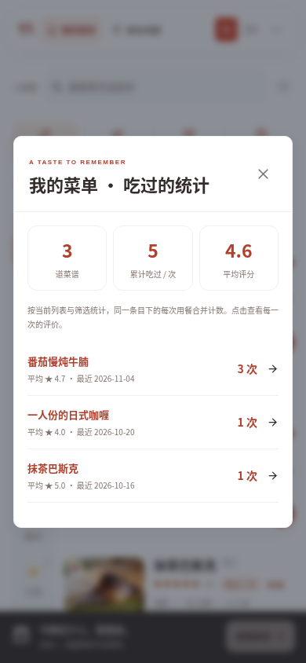

## 随机吃 / 收藏里吃

菜单抽菜谱，地图抽店铺；收藏里吃只使用当前列表中已标记心头好的候选。地图抽中后可以查看日记或直接定位。

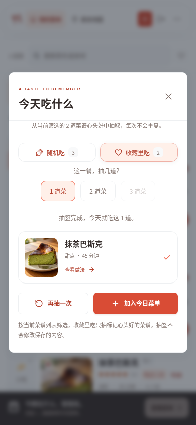 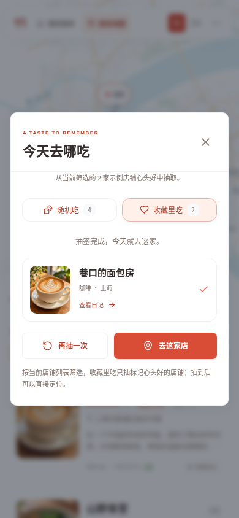

## 电脑布局

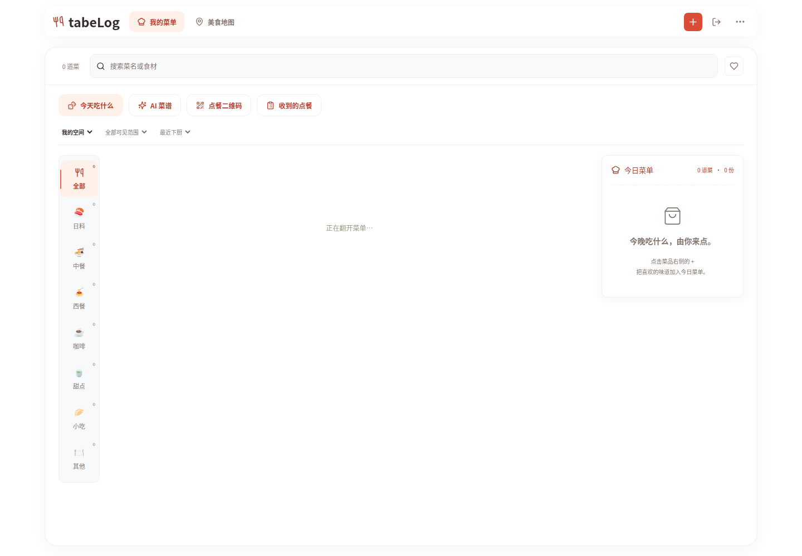

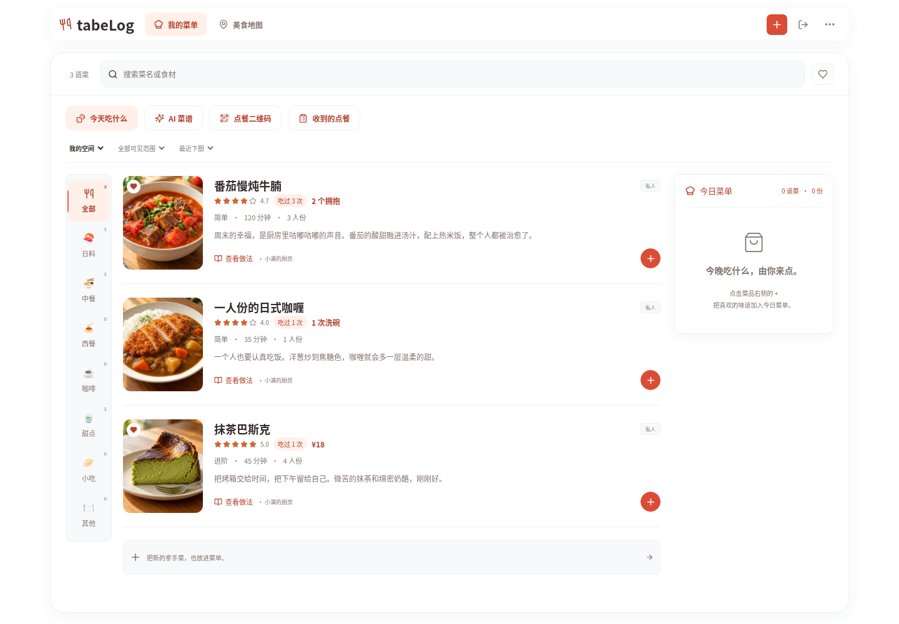
