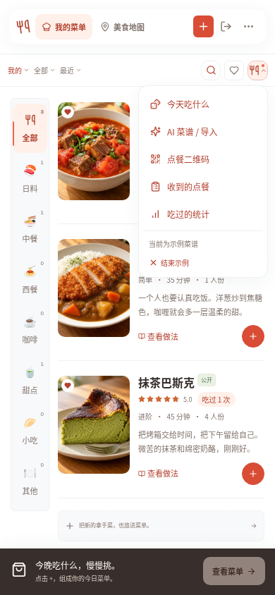
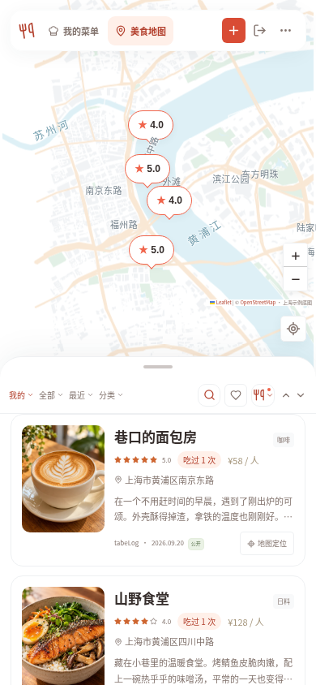
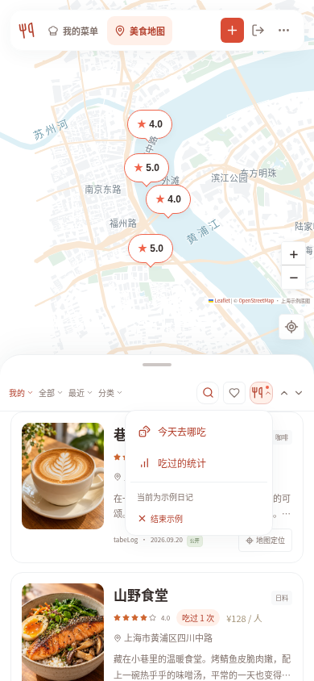
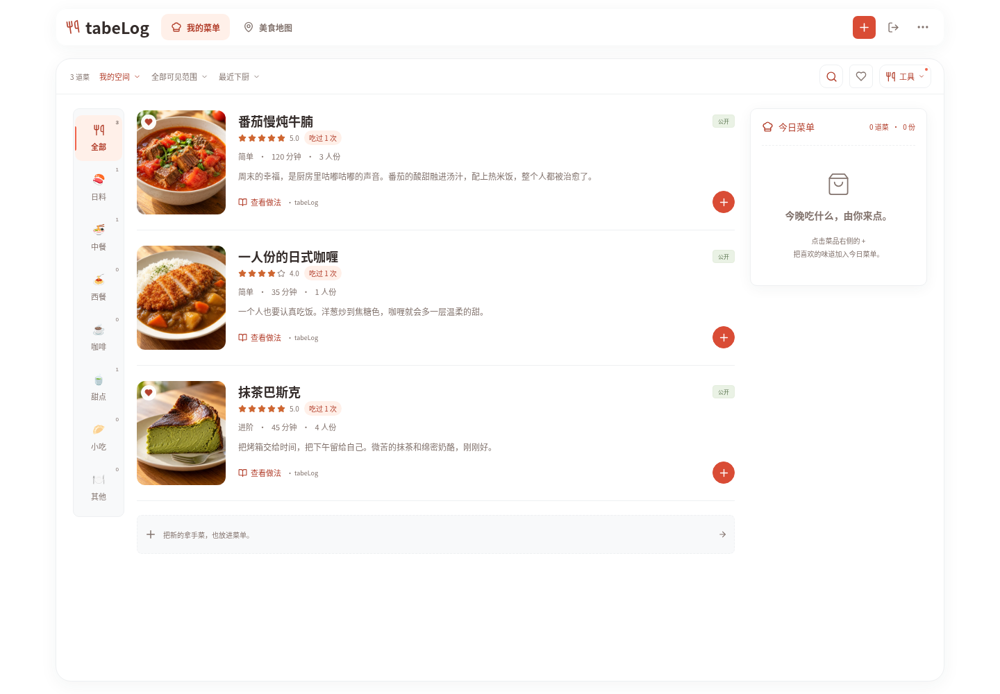
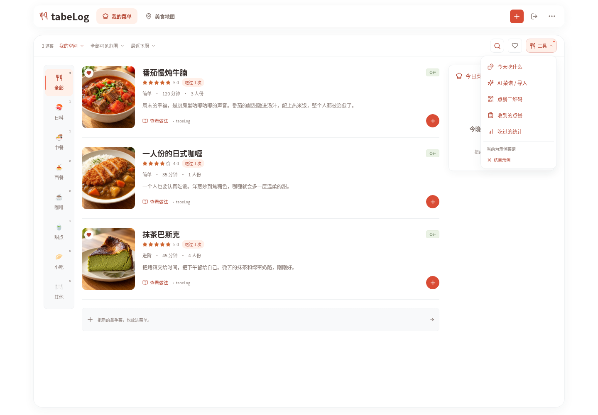
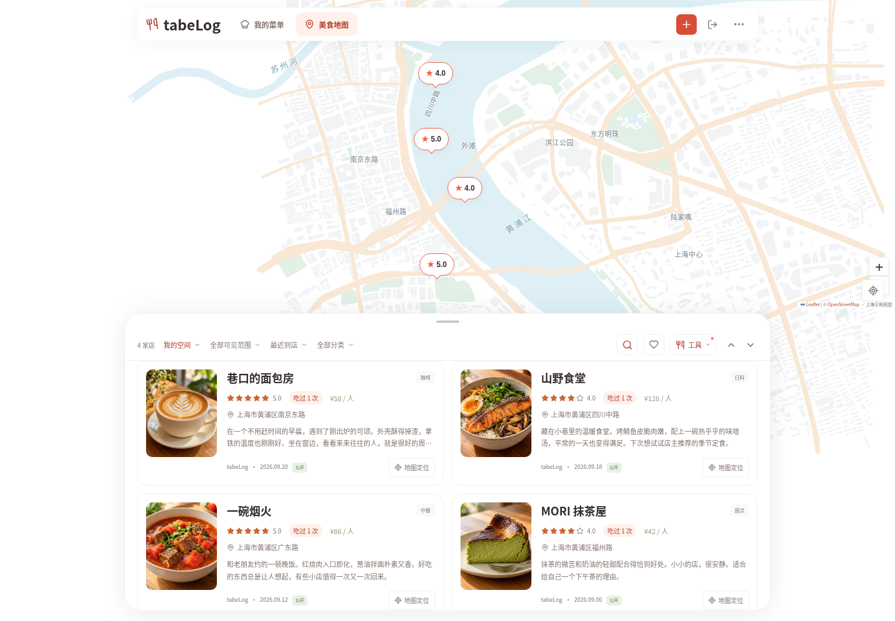
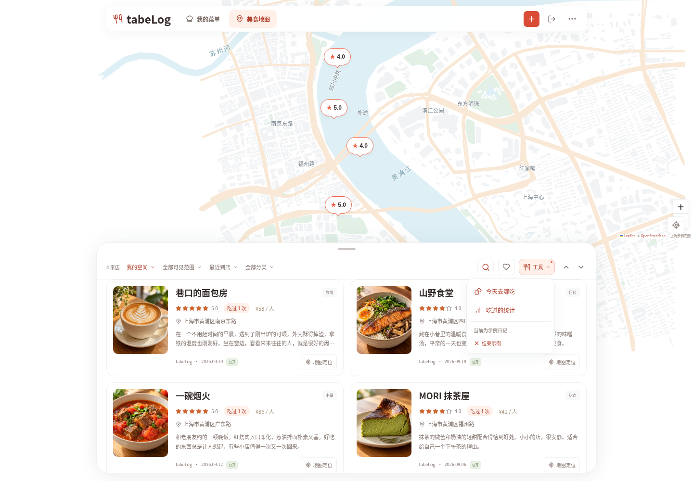

# 单行工具栏与工具下拉菜单

实际运行界面截图，使用隔离的演示账户与示例内容，食物图沿用已标注的 AI 演示图片。

浏览空间、可见范围、排序、地图分类、搜索、收藏和工具按钮都在同一行。手机上缩短选中项的显示文字，展开选择器仍显示完整选项。「今天吃什么」、AI 菜谱、点餐二维码、收到的点餐和统计默认隐藏，点击工具按钮展开。

菜单分类栏、菜品和已选清单跟随同一个内容区滚动，清单不再嵌套独立滚动条；点餐清单和分享选择弹窗也只由弹窗统一滚动。

## 手机菜单

 

## 手机美食地图

 

## 电脑菜单

## 电脑美食地图

