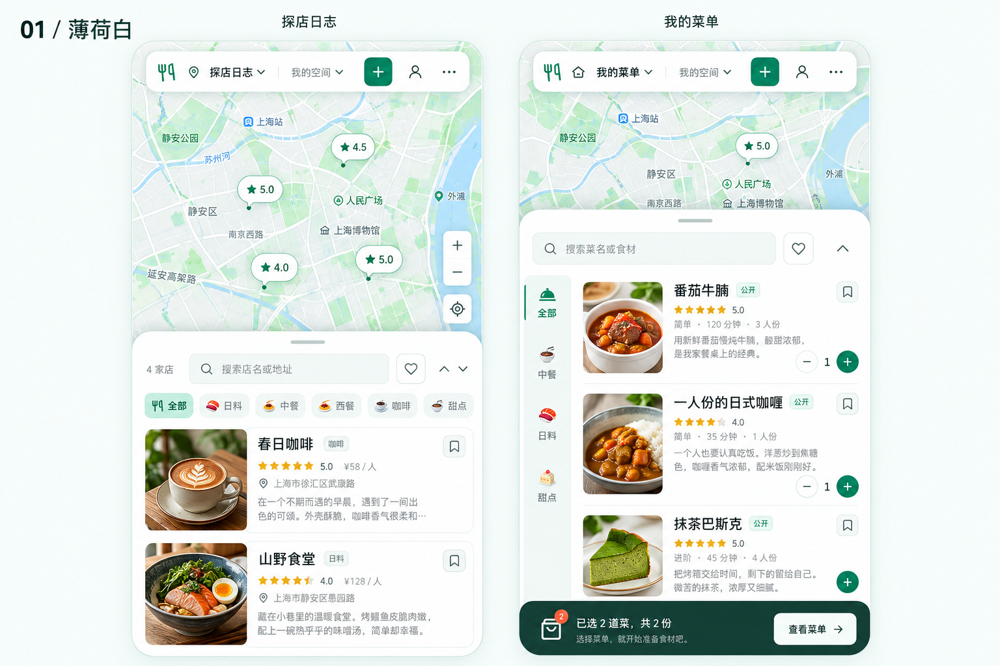
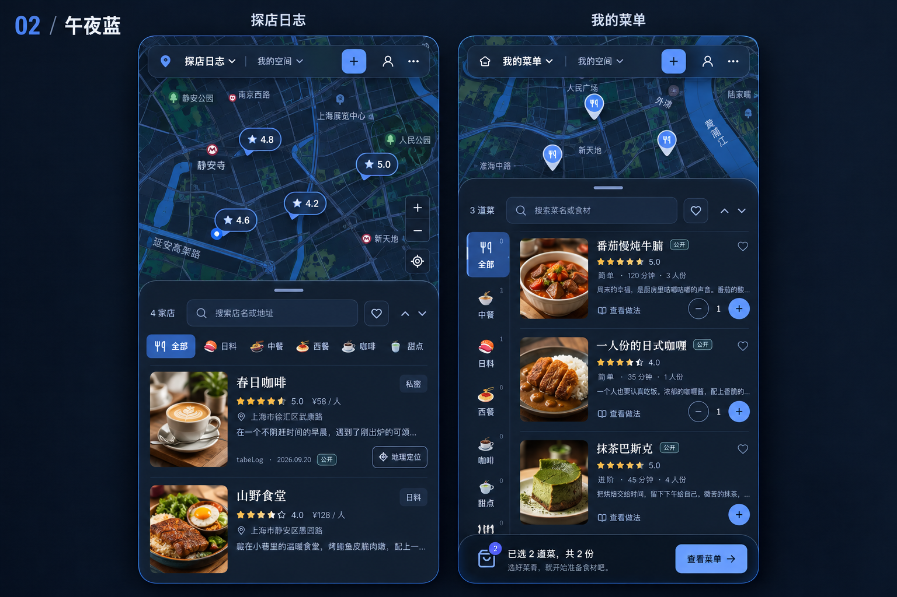
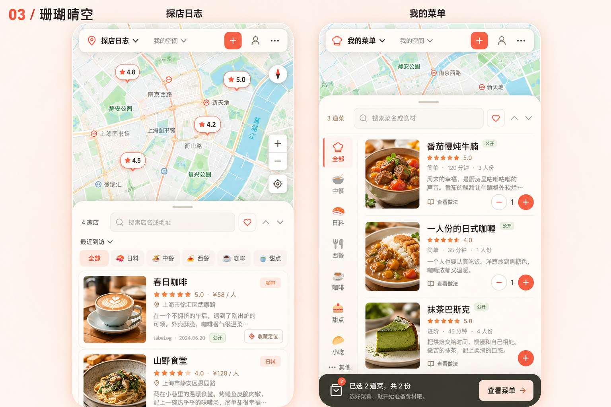
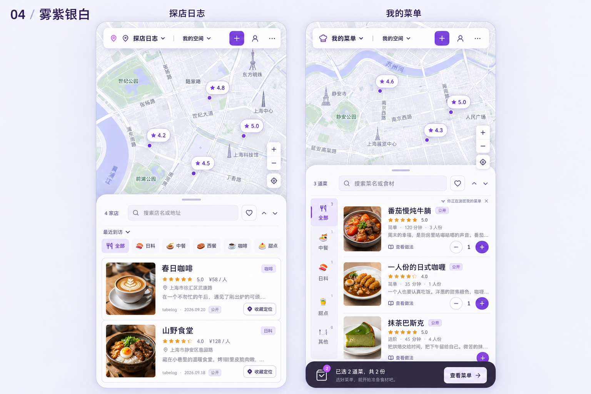

# tabeLog 主题方案

四套原始视觉提案，每张图包含「探店日志」和「我的菜单」。以下为设计效果图。

项目默认使用「珊瑚晴空」，可在「更多操作 → 设置 → 外观主题」切换这四套配色或「经典原色」。[查看当前实际界面截图](../screenshots/themes/README.md)；地图和照片以实际服务及用户上传内容为准。

## 01 · 薄荷白

## 02 · 午夜蓝

## 03 · 珊瑚晴空

## 04 · 雾紫银白

